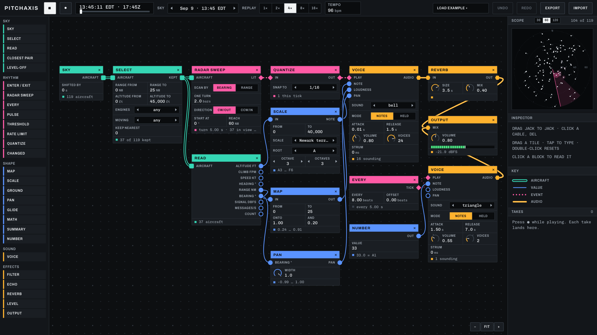

# Patchbay

A block editor for turning recorded ADS-B aircraft data into sound, part of the Pitchaxis project. It is described in
the technical note *Patchbay: a block model for the sonification of ADS-B aircraft data*
([doi:10.5281/zenodo.23647089](https://doi.org/10.5281/zenodo.23647089)), whose source is in `note/`.



## Try it

Open https://arquicanedo.github.io/patchbay/, or open `editor/pitchaxis-patchbay.html` from a clone in a browser. It
is one file and needs no server. It replays two 30-minute
captures from a receiver in central New Jersey, recorded on 9 September 2026.

## What is here

- `editor/`: the editor's source (`app.html`, `app.js`), the scripts that pack the captures and build the page, the
  built page, and its tests.
- `captures/`: the two captures, one readsb `aircraft.json` frame about every five seconds.
- `census/`: `census.py` and its aggregate output `census.json`, the measurement behind Section 2 of the note.
- `note/`: the LaTeX source of the note, its figures, and the scripts that reproduce its numbers.

## Rebuild the page

```
cd editor
python3 pack.py path/to/types.json   # captures -> data.js
python3 build.py                      # app.html + app.js + data.js -> pitchaxis-patchbay.html
```

`pack.py` needs `types.json`, a map from ICAO type designator to wake category, engine type and description code, for
example `"A320": ["M", "JET", "L2J"]`. It is extracted from the
[tar1090 aircraft database](https://github.com/wiedehopf/tar1090-db), which declares no licence, so it is not included.
`data.js` and the built page are committed, so you need it only to change the captures or the packing.

## Tests and checks

```
npm install && npx playwright install chromium
node editor/test-duet.cjs        # Closest pair, Pulse, Level-off and Ground, run against the built page

cd note
uv run check_flight_levels.py    # the Flight levels table
uv run check_intervals.py        # the interval counts of the musical-choices section
(cd figures && uv run make_census_figures.py)
tectonic scan-as-a-block-note.tex
```

## The data

The captures are the output of the author's own receiver, running readsb. The fields readsb adds from its aircraft
database (registered owner or operator, year of manufacture and type description) and the receiver's network address
were removed. Everything else is as recorded, including the antenna position, callsigns and ICAO addresses.

"Close pass" in the Closest pair block is a prediction from recorded positions. It is not an assessment of separation,
and Patchbay is not an operational tool.

## Citation

Canedo, A. (2026). *Patchbay: a block model for the sonification of ADS-B aircraft data* (Technical note). Zenodo.
https://doi.org/10.5281/zenodo.23647089

## Licence

The code is under the MIT License (`LICENSE`). The note, its figures, the captures and `census.json` are under
[CC BY 4.0](https://creativecommons.org/licenses/by/4.0/).
